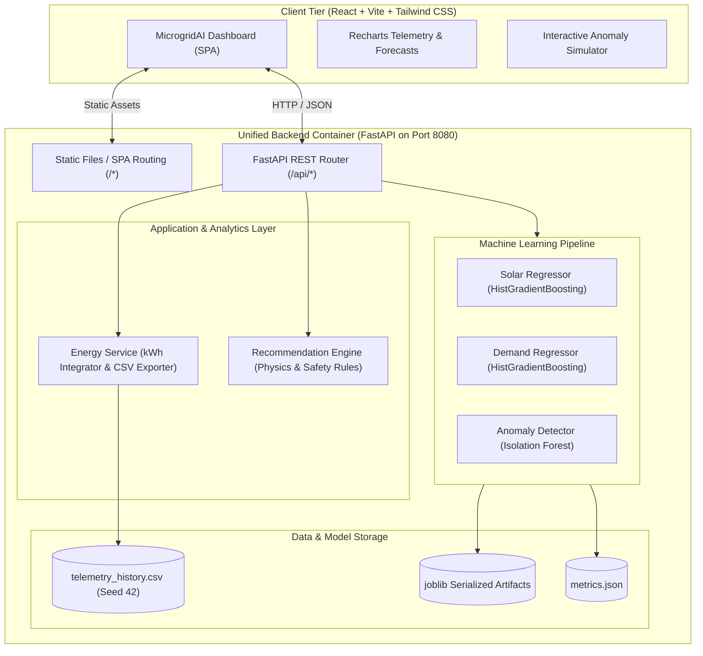

# MicrogridAI — Smart Renewable Energy Intelligence Platform

> **AI-Powered Renewable Microgrid Monitoring, 24-Hour Horizon Forecasting, Isolation Forest Anomaly Detection, and Storage Dispatch Management.**

[](LICENSE)
[](https://www.python.org/)
[](https://fastapi.tiangolo.com/)
[](https://react.dev/)
[](https://tailwindcss.com/)
[](https://cloud.google.com/run)

---

## 1. Project Overview

**MicrogridAI** is an industrial-grade renewable energy intelligence platform engineered for microgrids, commercial solar-plus-storage facilities, and university energy systems. The platform delivers real-time power balancing, predictive solar generation and load forecasting, machine learning anomaly detection, and physics-constrained battery dispatch optimization.

### Key Objectives
* **Real-time Microgrid Telemetry:** Continuous monitoring of solar PV generation (kW), facility electricity demand (kW), battery State of Charge (SoC %), and utility grid interchange.
* **Multi-Horizon AI Forecasting:** 24-hour ahead regression models (`HistGradientBoostingRegressor`) predicting solar output and demand loads to optimize self-consumption.
* **Unsupervised Anomaly Detection:** An `Isolation Forest` model identifying equipment failures (e.g., solar inverter trips, sudden load spikes, and thermal overrun).
* **Smart Storage Dispatch Engine:** Rule-based optimization calculating battery charge and discharge setpoints respecting safe depth-of-discharge (15%–95% SoC) constraints.
* **Single-Container Deployment:** Packaged as a unified multi-stage container serving the FastAPI REST API and compiled React SPA from one Google Cloud Run service.

---

## 2. System Architecture



---

## 3. Technology Stack

| Layer | Technologies |
| :--- | :--- |
| **Frontend** | React 18, Vite 5, Tailwind CSS, Recharts, Lucide React, JetBrains Mono |
| **Backend** | Python 3.11+, FastAPI, Uvicorn, Pydantic v2, Pandas, NumPy |
| **Machine Learning** | Scikit-learn (`HistGradientBoostingRegressor`, `IsolationForest`), Joblib |
| **Data Handling** | Deterministic diurnal solar simulator, numerical trapezoidal kWh integration |
| **DevOps & Cloud** | Multi-stage Docker, Google Cloud Run, Google Cloud Build |

---

## 4. Machine Learning Methodology & Metrics

MicrogridAI relies on real model training and chronological evaluation on test splits without data leakage.

### A. 24-Hour Solar & Demand Forecasting
* **Features:** 
  * Cyclical temporal transforms: $\sin(2\pi \cdot h / 24)$, $\cos(2\pi \cdot h / 24)$, day-of-week harmonics.
  * Autoregressive lags: $t-1\text{h}$, $t-24\text{h}$ (yesterday's reading), $t-48\text{h}$, and 24-hour rolling averages.
  * Meteorological parameters: Ambient cell temperature ($^\circ\text{C}$), solar irradiance ($\text{W/m}^2$), cloud cover percentage.
* **Evaluation (Chronological 80/20 Train/Test Split):**
  * **Solar Model:** $\text{MAE} = 0.077\text{ kW}$ vs Persistence Baseline $\text{MAE} = 1.217\text{ kW}$ (**93.7% error reduction**).
  * **Demand Model:** $\text{MAE} = 0.548\text{ kW}$ vs Persistence Baseline $\text{MAE} = 0.869\text{ kW}$ (**36.9% error reduction**).
  * Enforces strict physical non-negativity constraint ($P_{\text{solar}} \ge 0.0\text{ kW}$).

### B. Isolation Forest Anomaly Detection
* **Model:** Unsupervised `IsolationForest` ($n_{\text{estimators}}=150, \text{contamination}=0.04$).
* **Features:** Multi-dimensional state vector: `[solar_kw, demand_kw, battery_soc, battery_power_kw, ambient_temp_c, grid_import_kw]`.
* **Benchmark Evaluation:** Tested on ground-truth labelled benchmark cases including:
  * Midday Solar Inverter Tripping (high irradiance, zero generation).
  * Critical Facility Load Surges ($>3\sigma$ above normal maximum).
  * Dangerous Battery Thermal Runaway combined with excessive discharge.
* **Decision Scoring:** Calibrated sigmoid normalization mapping raw decision depth to a $[0.0, 1.0]$ severity index with automated signal attribution.

---

## 5. API Reference

All routes are fully documented via FastAPI's interactive OpenAPI documentation at `/docs`.

| Method | Endpoint | Description |
| :--- | :--- | :--- |
| `GET` | `/api/health` | Container liveness and model warm-up health check |
| `GET` | `/api/dashboard` | Aggregated real-time KPIs, power balance, forecast overview, alerts |
| `GET` | `/api/energy/history` | Historical telemetry series with time filters (`24h`, `7d`, `30d`) |
| `GET` | `/api/energy/export-csv` | Generates downloadable CSV telemetry report |
| `GET` | `/api/forecast` | Next 24-hour hourly predictions with persistence baselines |
| `POST` | `/api/anomalies/detect` | Real-time telemetry inference returning anomaly score & root cause |
| `GET` | `/api/anomalies` | Historical anomalies log and model evaluation benchmark metrics |
| `GET` | `/api/recommendations` | Physics-constrained dispatch recommendations and math formulas |
| `GET` | `/api/model/metrics` | Transparent ML regression metrics (MAE, RMSE, $R^2$) |
| `POST` | `/api/system/refresh-telemetry` | Re-runs deterministic data generator to simulate fresh cycles |

---

## 6. Local Installation & Development

### Prerequisites
* **Python 3.11+** installed
* **Node.js 18+** and **npm** installed
* **Git** installed

### Windows PowerShell Quickstart

```powershell
# 1. Clone repository and navigate to folder
cd microgridai

# 2. Setup Python backend
cd backend
python -m venv venv
.\venv\Scripts\Activate.ps1
python -m pip install --upgrade pip
pip install -r requirements.txt

# 3. Train ML models & generate demonstration telemetry
python -m app.ml.train_models

# 4. Run Backend test suite
pytest -v

# 5. Start Backend development server (Runs on port 8080)
python -m uvicorn app.main:app --host 0.0.0.0 --port 8080 --reload
```

In a second PowerShell terminal:

```powershell
# 6. Setup and run Frontend development server
cd microgridai/frontend
npm install
npm run dev
```

Open **`http://localhost:5173`** in your browser. The Vite dev server proxies `/api` calls directly to the FastAPI backend at `http://localhost:8080`.

---

## 7. Single-Container Production Build & Local Docker Test

Build the unified container locally to verify the multi-stage Docker build:

```powershell
# From the root microgridai/ directory:
docker build -t microgridai:latest .

# Run container on port 8080
docker run -d -p 8080:8080 -e PORT=8080 --name microgridai-app microgridai:latest

# Verify health endpoint
curl http://localhost:8080/api/health

# Open application in browser
start http://localhost:8080
```

---

## 8. Google Cloud Run Deployment Guide

MicrogridAI is built to deploy seamlessly as a single serverless container on **Google Cloud Run**.

### Step 1: Install & Initialize Google Cloud CLI
If the `gcloud` CLI is not installed, download the [Google Cloud CLI Installer](https://cloud.google.com/sdk/docs/install-windows).

```powershell
# Authenticate with your Google account
gcloud auth login

# Set or create your Google Cloud Project
gcloud projects create microgridai-demo --name="MicrogridAI Platform"
gcloud config set project microgridai-demo

# Link your Cloud Billing Account
gcloud beta billing accounts list
gcloud beta billing projects link microgridai-demo --billing-account=YOUR_BILLING_ACCOUNT_ID
```

### Step 2: Enable Required Google Cloud APIs
```powershell
gcloud services enable run.googleapis.com cloudbuild.googleapis.com artifactregistry.googleapis.com
```

### Step 3: Deploy Directly via Cloud Run Source Deploy
Run this single command from the root `microgridai/` directory:

```powershell
gcloud run deploy microgridai `
    --source . `
    --region us-central1 `
    --platform managed `
    --allow-unauthenticated `
    --port 8080 `
    --memory 1Gi `
    --cpu 1 `
    --min-instances 0 `
    --max-instances 2
```

Cloud Build automatically packages the multi-stage Dockerfile, builds the frontend, trains the ML models, and outputs a public secure URL:
```
Service URL: https://microgridai-xxxxxx-uc.a.run.app
```

Verify deployment via:
```powershell
curl https://microgridai-xxxxxx-uc.a.run.app/api/health
```

---

## 9. Git Repository Initialization

Follow these exact commands to commit and connect your own GitHub repository:

```powershell
cd d:\6ab10eb3b23ba_student_resource\microgridai

# Initialize Git
git init

# Stage all files
git add .

# Initial Commit
git commit -m "feat: complete MicrogridAI renewable intelligence platform"

# Rename branch to main
git branch -M main

# Add your GitHub remote repository (replace with your repository URL)
# Example: git remote add origin https://github.com/your-username/microgridai.git
git remote add origin YOUR_GITHUB_REPOSITORY_URL

# Push to GitHub
git push -u origin main
```

---

## 10. Educational Note: Power (kW) vs Energy (kWh)

In microgrid design, confusing instantaneous **power** and cumulative **energy** leads to severe sizing errors:
* **Power (kW):** Represents the instant flow rate of electrical charge ($P = V \times I$). Solar panel peak capacity and inverter ratings are measured in kW.
* **Energy (kWh):** Represents total work accumulated over time ($E = \int P \, dt$). Battery storage capacity and utility tariff bills are measured in kWh.
* A $20\text{ kW}$ solar array operating at maximum irradiance for $3.5\text{ hours}$ produces $70\text{ kWh}$ of energy.

---

## 11. License

This project is licensed under the [MIT License](LICENSE).
MicrogridAI — Smart Renewable Energy Intelligence.
